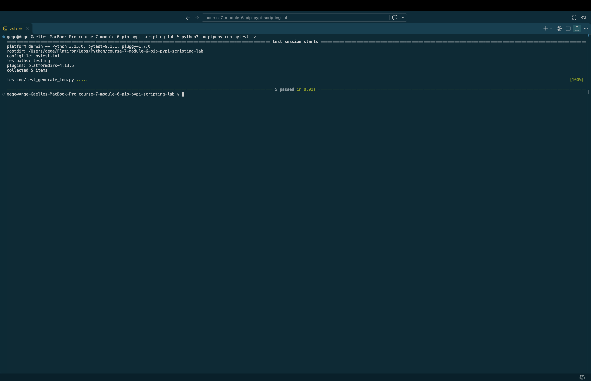

# Module Lab: Automating Python Projects with Pip, PyPi & Scripting

## Learning Goals

- Automate Python tasks using command-line scripts.
- Use pip to install and manage external packages.
- Write modular Python scripts with clean entry points.
- Track dependencies using a requirements.txt file.
- Generate structured outputs using file I/O techniques.

## Introduction

In this lab, you will build a **Python automation tool** that uses pip-installed packages and scriptable logic to automate a real-world task. Your script will:

- Use pip to install third-party packages (e.g., `requests`).
- Fetch or process external data.
- Write structured output to a local file.
- Track all dependencies in `requirements.txt` for reproducibility.

This lab emphasizes automation, scripting practices, and environment management using the standard Python ecosystem.

## Setup Instructions

### Fork and Clone the Repository

1. Go to the provided GitHub repository link.
2. Fork the repository to your GitHub account.
3. Clone the forked repository to your local machine using:

```bash
git clone <repo-url>
cd module-lab-pip-pypi-scripting
```

### Install Python and pip

Ensure Python and pip are installed:

```bash
python --version
pip --version
```

Optionally, create a virtual environment:

```bash
python -m venv venv
source venv/bin/activate  # macOS/Linux
venv\Scripts\activate   # Windows
```

Install any required dependencies:

```bash
pip install -r requirements.txt
```

## Tasks

### Task 1: Define the Problem

Your goal is to create a **Python script** that automates a small task:

- Uses one or more pip-installed packages (e.g., `requests`, `pandas`, `rich`)
- Outputs data to a `.txt` or `.csv` file using File I/O
- Logs or prints messages to confirm behavior
- Is executable from the command line
- Records dependencies in `requirements.txt`

---

### Task 2: Determine the Design

You will implement a script with the following design principles:

- Use `pip` to install packages
- Import modules inside a Python script
- Wrap logic in `if __name__ == "__main__"` to support reusability
- Structure output files with filenames that include timestamps
- Track dependencies using `pip freeze > requirements.txt`

---

### Task 3: Develop and Run Your Script

#### Step 1: Create a script called `generate_log.py`

```python
from datetime import datetime

log_data = ["User logged in", "User updated profile", "Report exported"]
filename = f"log_{datetime.now().strftime('%Y%m%d')}.txt"

with open(filename, "w") as file:
    for entry in log_data:
        file.write(f"{entry}\n")

print(f"Log written to {filename}")
```

#### Step 2: Add an API integration using `requests`

```python
import requests

def fetch_data():
    response = requests.get("https://jsonplaceholder.typicode.com/posts/1")
    if response.status_code == 200:
        return response.json()
    return {}

if __name__ == "__main__":
    post = fetch_data()
    print("Fetched Post Title:", post.get("title", "No title found"))
```

#### Step 3: Track your dependencies

After installing any packages with `pip install ...`, run:

```bash
pip freeze > requirements.txt
```

---

## Best Practices

- Use clear function names (`fetch_data`, `write_log`) for clarity.
- Always check file write success with print or logging statements.
- Avoid hardcoding data—use variables and functions where appropriate.
- Use virtual environments to isolate dependencies.
- Wrap script logic in `if __name__ == "__main__"` for script reusability.

---

## Conclusion

After completing this lab, you will:

✅ Automate tasks with Python scripting  
✅ Use external packages from PyPi with pip  
✅ Track project dependencies with `requirements.txt`  
✅ Generate structured output files from your script  
✅ Structure projects for portability and collaboration

These scripting and packaging skills are essential for building automation tools and working in modern Python development workflows.

### 1. Clone the Repository

```bash
git clone git@github.com:a-gbatie/course-7-module-6-pip-pypi-scripting-lab.git
```

### 2. Set Up Python 3.10

```bash
python3 -m pipenv --python /opt/homebrew/bin/python3.10
```

### 3. Install Dependencies

```bash
python3 -m pipenv install
```

## How to Run

You can call the `generate_log()` function from another Python file:

```python
from lib.generate_log import generate_log

entries = [
    "User logged in",
    "User updated profile",
    "Report exported"
]

filename = generate_log(entries)

print(filename)
```

The function creates a text file using the following naming convention:

```text
log_YYYYMMDD.txt
```

For example:

```text
log_20261107.txt
```

### Example File Contents

```text
User logged in
User updated profile
Report exported
```

## Running Tests

Run the test suite from the project directory:

```bash
python3 -m pipenv run pytest -v
```
## Screenshot of Completed Tests
